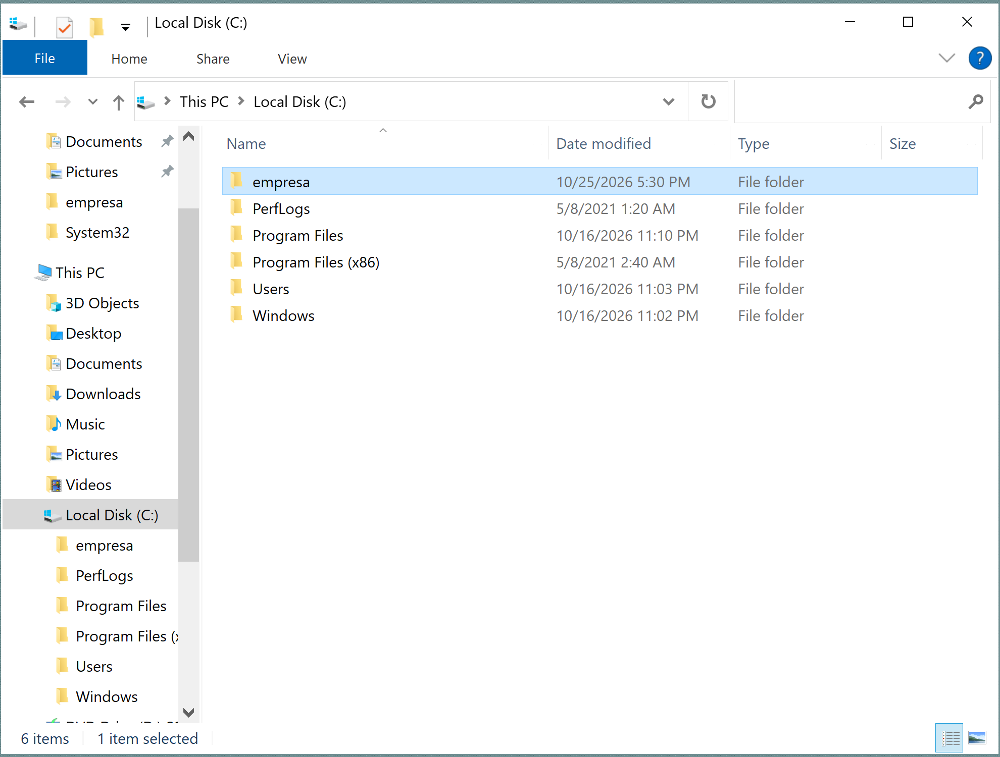
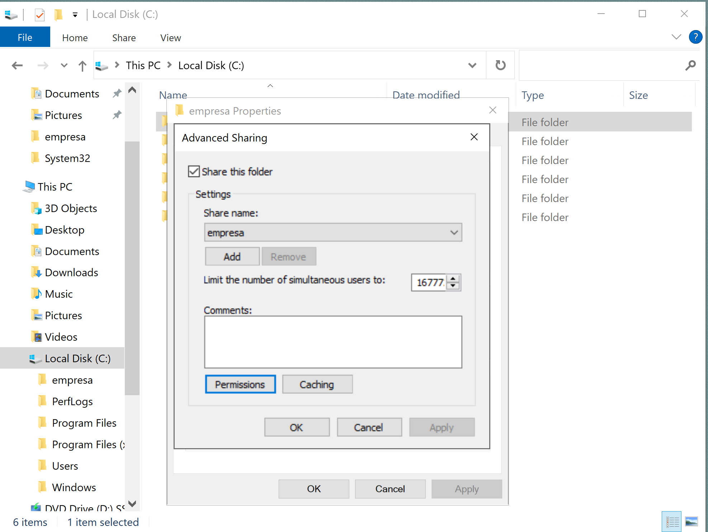
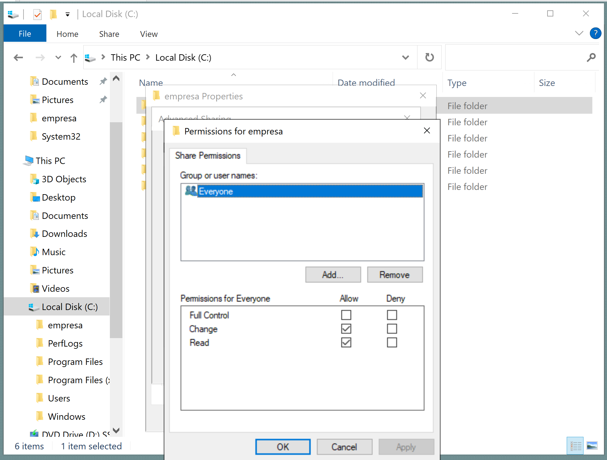
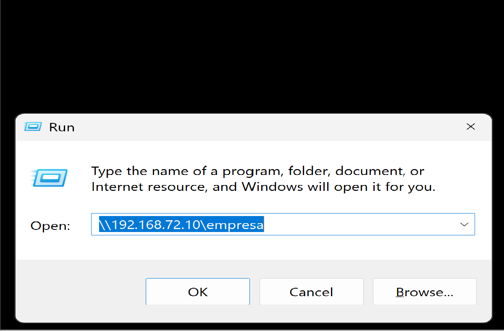
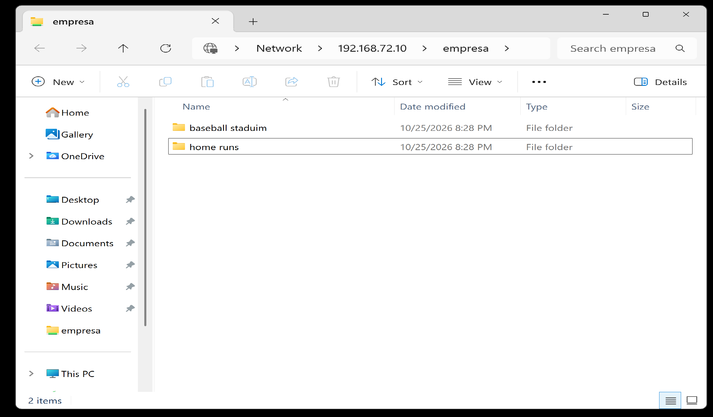

# Windows Server IT Labs

## Lab 01 — SMB File Sharing Between Windows Server and Windows 11

### Objective
Configure a shared folder between two virtual machines without using Active Directory.

### Lab Environment
- VMware Workstation
- DC01: Windows Server 2022
- PC01: Windows 11
- Network: VMware NAT
- Server IP: 192.168.72.10

### Technologies
- SMB File Sharing
- NTFS Permissions
- Local User Authentication
- Windows Networking

### Configuration
1. Created C:\Empresa on DC01.
2. Enabled Advanced Sharing for the folder.
3. Configured SMB permissions for Everyone with Read and Change.
4. Connected from PC01 using the SMB network path.
5. Authenticated using an existing local account on DC01.

### Results
Successfully accessed the shared folder from PC01 using local account authentication, without Active Directory.

### Next Steps
- Test file creation and modification from PC01.
- Configure more restrictive NTFS permissions.
- Document troubleshooting and security improvements.

### Screenshots
### Lab Screenshots

The following screenshots document the SMB file sharing lab between DC01 and PC01.

#### Screenshot 1

#### Screenshot 2

#### Screenshot 3

#### Screenshot 4

#### Screenshot 5

  ## Video Demonstration

[▶ Watch Network Connectivity Lab Video](https://github.com/Wily-IT-Labs/windows-Server-IT-Labs/blob/main/Windows%20Server%202022%20Network%20Connectivity%20Lab.%20Mp4.mp4)

Watch the hands-on demonstration of network
connectivity testing between Windows Server
2022 and Windows 11 virtual machines.
